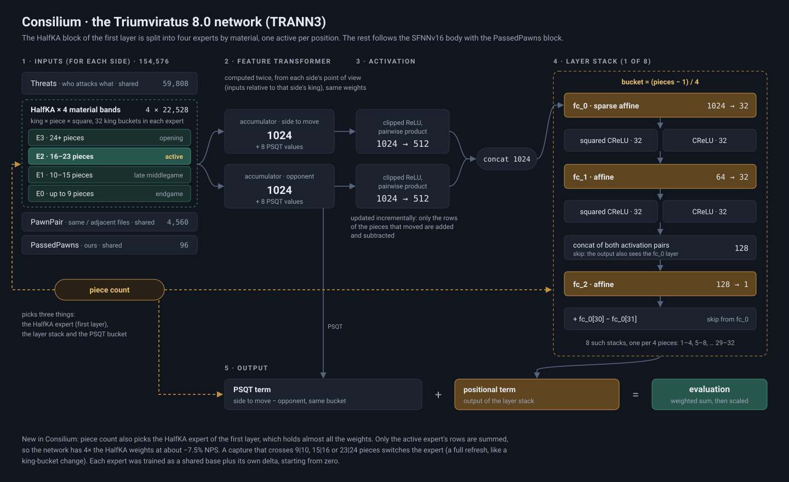

# Triumviratus

**A strong UCI chess engine in C++** · mixture-of-experts NNUE · SPSA-tuned alpha-beta search · Syzygy tablebases

**by Francesco Torsello**

in collaboration with Maurizio Platino

**Current version: [Triumviratus 8.0](https://github.com/Tors3/Triumviratus/releases/tag/v8.0)** (official release, October 2026)

---

[8.0](#triumviratus-80) · [Strength](#strength) · [Download](#download) · [Rating lists](#rating-lists) ·
[Earlier releases](#earlier-releases) · [What is new](NOVELTIES.md) · [Dev log](DEVELOPMENT_8.1.md) ·
[Networks](NETWORKS.md) · [Future directions](FUTURE_DIRECTIONS.md) · [Tests](tests/) · [History](HISTORY.md) ·
[License](#license) · [Credits](#credits)

---

## Triumviratus 8.0

**Consilium**, the 8.0 network, is a mixture-of-experts network: its largest layer, the king-relative HalfKA inputs,
is split into **four experts, one per material band** (chosen by the number of pieces, on top of the usual king
buckets); only one is active at a time, so the layer has four times the weights at almost the cost of one. To our
knowledge it is **the first engine with piece-count buckets on the input layer**. The idea is the author's own, from
the mixture-of-experts models of language AI.

> **What "mixture of experts" means here.** The experts are chosen by a fixed rule, the number of pieces on the
> board, not by a learned gate as in language models. In this sense other routing schemes of NNUE networks are also
> experts: king buckets on the input layer (chosen by king square) and output buckets or layer stacks after the
> accumulator (chosen by piece count). What is new in Consilium is not the routing itself but where piece count is
> used: on the input layer, which holds almost all the weights, rather than only in the small layers after it.

[How it was built](NETWORKS.md#consilium--the-triumviratus-80-network) ·
[why it is new](NOVELTIES.md#1-consilium-experts-by-material-on-the-first-layer)

What else is new in 8.0 ([`NOVELTIES.md`](NOVELTIES.md) compares each technique with the published work of other
engines):

- **`PassedPawns`**, an input block of our own for passed pawns;
- **corrections per network expert** (`CorrPhase`) and **search margins per expert**;
- **move ordering with chess knowledge**: knight outposts, the capture of a bishop of the pair;
- **time management**: more time when the opponent does not play the expected reply (the surprise rule), less time
  when behind on the clock, rules for defending;
- a **restructured search**, re-tuned by SPSA on Consilium, with the **causal reduction** of quiet moves;
- faster code at an identical search tree, buffered UCI I/O and a high-resolution clock;
- **Chess960** support, and **one executable for every x86-64 CPU** with AVX2.

## Strength

The release 8.0, 1 thread per engine:

| opponent | games | conditions | +W =D −L | Elo (Triumviratus) |
|---|---:|---|---|---:|
| **Triumviratus 7.0** | 400 of 4,000 | 20+0.2, UHO 2024 | +177 =189 −34 | **+129.9 ± 15.7** |
| **Triumviratus 7.0** | 4,000 (final) | 5+0.05, UHO 2024 | +1773 =1864 −363 | **+128.0 ± 5.6** |
| **Stockfish 19** | 240 of 600 | 133+1 (CCRL Blitz), TopGM openings | +5 =227 −8 | **−4.3 ± 6.3** |
| **Stockfish 18** | 600 (final) | 133+1 (CCRL Blitz), TopGM openings | +20 =568 −12 | **+4.6 ± 5.0** |
| **Stockfish 18** | 2,000 (final) | 40+0.4, UHO 2024 | +530 =1082 −388 | **+24.7 ± 7.2** |

The Stockfish 18 matches and 7.0 at 5+0.05 are final (games of the UHO match in [`tests/games`](tests/games)); the other matches are still running and will be completed after the release. All results are counted on complete opening pairs only. ± is the 95% interval on
the opening pairs (pentanomial); against Stockfish 19 almost every pair is drawn, which makes the interval small.

**Test suites:**

| suite | tester | result |
|---|---|---|
| IQ4 (183 positions, 1 s, 1 thread) | Maurizio Platino | **155 / 183**, second of six; Stockfish 19 142 |
| IQ4 (183 positions, 1 s) | Mark Tang | 145 / 183, highest among the engines tested |
| ENET 2026 (110 positions) | Maurizio Platino | 89 / 110; Stockfish 19 91 |

Other engines: Andres (EveAnn)'s gauntlet of the 11 October pre-release scored **62.8%, +91.2 ± 9.4** against fifteen
engines (1,500 games); Maurizio Platino measured **+94 ± 16** against Stormphrax 8.0.0 and **+25.5 ± 14.6** against
Reckless 0.10.0-dev. Games and details: [`tests/`](tests/) and
[Triumviratus-Testing](https://github.com/Tors3/Triumviratus-Testing).

## Download

From the [v8.0 release](https://github.com/Tors3/Triumviratus/releases/tag/v8.0):
`Triumviratus_8.0_windows_universal.exe`, one file for every x86-64 CPU with SSE4.1, with the network embedded. At start-up it
picks the best of six builds for the CPU (SSE4.1 for CPUs without AVX2, AVX2 without PEXT, AVX2,
AVX-512, AVX-512 VNNI, AVX-512 VBMI2). The engine
name is `Triumviratus - 8.0`. To build it from source: `build/bootstrap_release_laptop.ps1` (Windows, PGO), or
`source/universal/build_universal.ps1 -Official`. The same release has builds for **Android** (arm64, with and
without the dot-product instructions) and **macOS** (Apple Silicon and Intel), with the network embedded.

For the analysis of hard positions: [Triumviratus 8.0 Position Solver](https://github.com/Tors3/Triumviratus/releases/tag/v8.0-possolver),
the same engine with search settings chosen for test positions (analysis mode always on, a two-line search that pauses in quiet positions, a preference for the most
direct win). At 1 second per position it solves 153 of 183 on IQ4 and 157 of 200 on Arasan 2026, against 145 and 137 for 8.0
and 139 and 140 for Stockfish 19
(details in [DEVELOPMENT_8.0.md §49](archive/DEVELOPMENT_8.0.md)). For games, use 8.0.

## Rating lists

8.0 has not been listed yet.

**CCRL Blitz** (2 min + 1 s)

| version | rating | rank | list |
|---|---:|---:|---|
| **Triumviratus 7.0** (1 CPU) | **3757** ± 19 | **8** | 2026-09-26 |
| Triumviratus 6.0 (1 CPU) | 3749 ± 13 | 12–14 | 2026-08-16 |
| Triumviratus 4.2 (1 CPU) | 3670 ± 13 | 51–52 | 2026-08-08 |

**CCRL 40/15** (40 moves in 15 minutes, with increment)

| version | rating | rank | list |
|---|---:|---:|---|
| **Triumviratus 6.0** (4 CPU) | **3632** ± 17 | **13–14** | 2026-09-23 |
| Triumviratus 5.1 (1 CPU) | 3605 | | 2026-07-23 |
| Triumviratus 5.0 (4 CPU) | 3603 | | 2026-07-16 |
| Triumviratus 5.0 (1 CPU) | 3570 | | 2026-07-16 |

Ranks are tie bands shared by the engines inside the interval. The two lists are not comparable with each
other.

## Earlier releases

- **7.0** (tag `v7.0`): the network `legio-septima`, the first trained from scratch with all its blocks, including
  `PassedPawns`; +21.3 ± 6.7 over 6.0 at 25+0.25. [`archive/DEVELOPMENT_7.0.md`](archive/DEVELOPMENT_7.0.md)
- **6.0**: the `TRANN1` architecture, the `nn-rubicon-alea-v3` network and TMv2 time management; +53.0 ± 12.3 over
  5.1 at 40+0.4. [`archive/DEVELOPMENT_6.0.md`](archive/DEVELOPMENT_6.0.md)
- Older versions: [`HISTORY.md`](HISTORY.md).

---

## Contributing

The released code is on `main`; the work toward 8.1 is on the [`dev`](https://github.com/Tors3/Triumviratus/tree/dev)
branch. How to send code or test results: [CONTRIBUTING.md](https://github.com/Tors3/Triumviratus/blob/dev/CONTRIBUTING.md).

## License

> [!IMPORTANT]
> **GPLv3**, see [`COPYING`](COPYING). Because the engine incorporates Stockfish's GPL code, **the whole project is distributed under GPLv3**, with Stockfish's copyright notices preserved in every file that contains its code.
>
> **What is the project's own.** The network: Consilium, a mixture of four experts chosen by material (architecture TRANN3), trained by the project from random initialisation, with no Stockfish network as seed or teacher ([`NETWORKS.md`](NETWORKS.md)). The `PassedPawns` input block, an original feature. The time manager and its rules (the surprise rule, less time when behind on the clock, the defence rules). Per-expert search margins, the causal reduction and the other techniques listed as new in [`NOVELTIES.md`](NOVELTIES.md). The board, move generation, data structures and the link between search and network. The measurement method: every search change by SPRT, every speed change by hardware counters at an identical search tree, with the numbers published.
>
> **What comes from Stockfish.** The **NNUE inference code** started from Stockfish's SFNNv16 machinery in `nnue/`. For Consilium the part that runs at every node has been largely rewritten (accumulators, feature blocks, the link with the search); the forward pass (layers, SIMD) and the net loading are still Stockfish's, and a line-by-line count gives about 60–70% of the inference lines in common with Stockfish ([`source/nnue/README.md`](source/nnue/README.md)). The **search** was restructured in October 2026: its structures were already in the engine, accumulated since version 5.0, and they were reorganised on the **algorithmic base of Stockfish 19's search**, then re-tuned by SPSA on Consilium and extended with the project's own techniques. The search code is written in the project's own structure and names. The `PawnPair` input block implements a feature designed by Jonathan Hallström for Pawnocchio, also used by Stormphrax, Viridithas and Stockfish; the implementation and the weights are ours (see [Credits](#credits)).

## Credits

### Testing & tuning

**Maurizio Platino** is the project's tester and search-tuner. Beyond SPSA tuning, he tests the engine on hard
positions at long time controls and against other engines on his own machine, and shares with the author the cost of
the cloud GPUs on which the networks are trained, Consilium included. Triumviratus would be materially weaker without
his work.

**Mark Tang** is an important tester and collaborator of the project. He tested almost every 8.0 pre-release
extensively, in matches against Stockfish and other engines and on tactical test suites such as IQ4, and his reports
shaped the release. His remark that Stoofvlees answers very quickly between two moves started the line of thought that
led the author to the surprise rule of 8.0's time management. Many thanks to him.

**Andres (EveAnn)** ran a 1,500-game gauntlet of the 11 October 8.0 pre-release against fifteen engines, Stockfish 19
included.

### Code contributions

**A Tin Man**: speed at an identical search tree, the first external contribution (pull request 6, for 8.1). Details
in [Contributions](CONTRIBUTING.md#contributions).

### Code from other projects

- **[Stockfish](https://github.com/official-stockfish/Stockfish)** (GPLv3): the NNUE inference machinery in `nnue/`, ported from SFNNv16 and since extended for Triumviratus' own networks (the PassedPawns and PawnPair blocks, the four experts of Consilium, row permutation for cache locality, refresh caches, measured speed changes).
- **[BBC](https://github.com/maksimKorzh/chess_programming)** by Maksim Korzh: the original bitboard and magic-number move generator, the project's 2024 foundation, since rewritten and extended.
- **[Fathom](https://github.com/jdart1/Fathom)** (MIT): Syzygy tablebase probing.

### Open-source engines studied

Ideas for search, move ordering, time management and pruning were studied from these engines and, where adopted,
re-tuned on the project's own network:

- **[Stockfish](https://github.com/official-stockfish/Stockfish)**: the algorithmic base of the October 2026 search ([`DEVELOPMENT_8.0.md`](archive/DEVELOPMENT_8.0.md), section 17).
- **[Reckless](https://github.com/codedeliveryservice/Reckless)**: quiet move-ordering terms, TT prefetch, capture ordering.
- **[Caissa](https://github.com/Witek902/Caissa)**: node-count move cache, quiescence capture history, moves-left time curve.
- **[Alexandria](https://github.com/PGG106/Alexandria)**: the multiplicative time-management factors.
- **[Pawnocchio](https://github.com/JonathanHallstrom/pawnocchio)**, **[Viridithas](https://github.com/cosmobobak/viridithas)**: the `PawnPair` input feature.
- **[Berserk](https://github.com/jhonnold/berserk)**, **[Obsidian](https://github.com/gab8192/Obsidian)**, **[Ethereal](https://github.com/AndyGrant/Ethereal)**, **[Stormphrax](https://github.com/Ciekce/Stormphrax)**: search, pruning and ordering refinements.

**NNUE input features.** The **`PawnPair`** block (pairs of pawns on the same or adjacent files) was **invented by
Jonathan Hallström for [Pawnocchio](https://github.com/JonathanHallstrom/pawnocchio)**, also used by Stormphrax and
Viridithas, and adopted by Stockfish in July 2026 as `PP_3Wide`; our implementation and weights are our own, the idea
is his. The **`PassedPawns`** block (one input per passed pawn) is **an original feature of this project**.

The open-source computer-chess community is what makes a project like this possible.

Developed openly and with significant AI assistance.
