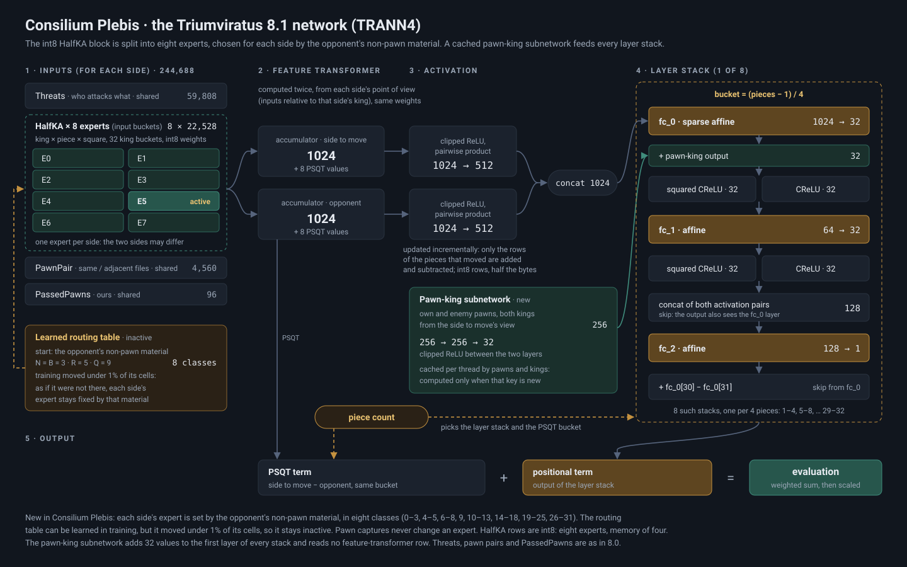

<picture><source media="(prefers-color-scheme: dark)" srcset="docs/images/logo_mark_dark.svg"></picture>

# Triumviratus

**A strong UCI chess engine in C++** · mixture-of-experts NNUE · SPSA-tuned alpha-beta search · Syzygy tablebases

**by Francesco Torsello**

in collaboration with Maurizio Platino

**Current release: [Triumviratus 8.0](https://github.com/Tors3/Triumviratus/releases/tag/v8.0)** (October 2026) · `main`: development of 8.1

**Triumviratus is becoming a community project.** The project has a Discord server where the development is followed,
ideas are shared and contributions are discussed: to join, just contact me ([@Tors3](https://github.com/Tors3) on
GitHub). Everyone is welcome, as long as discussions stay open and respectful.

---

[8.1](#triumviratus-81-in-development) · [8.0](#triumviratus-80) · [Rating lists](#rating-lists) · [Download](#download) · [What is new](docs/project/NOVELTIES.md) ·
[Networks](docs/networks/NETWORKS.md) · [Tests](docs/tests/) · [History](docs/project/HISTORY.md) ·
[Credits](#credits) · [License](#license)

---

## Triumviratus 8.1 (in development)

8.1 brings a new network, **Consilium Plebis**, trained from 21 to 28 October 2026: **+10.3 ± 4.3 Elo over Consilium**
with the same search at fixed nodes. Consilium chose its experts by the total piece count,
the same for both sides; Consilium Plebis gives **each side its own expert, chosen by the non-pawn material that side
is facing**, so positions with a material imbalance are read differently from the two points of view and a pawn more or
less no longer moves a position to another expert. The king-relative weights are **int8** (eight experts in the memory
of four), and a small **pawn-king subnetwork**, cached per thread, adds its view of the pawns and the kings to every
layer stack.

[Architecture and measurements](docs/networks/NETWORKS.md#consilium-plebis--the-network-of-triumviratus-81) ·
[network file](https://github.com/Tors3/Triumviratus-Networks/releases/tag/consilium-plebis) ·
[recipe](https://github.com/Tors3/Triumviratus-Networks/tree/main/recipes/07_consilium-plebis).

---

## Triumviratus 8.0

**Consilium**, the 8.0 network, is a mixture-of-experts network: its largest layer, the king-relative HalfKA inputs,
is split into **four experts, one per material band** (chosen by the number of pieces, on top of the usual king
buckets); only one is active at a time, so the layer has four times the weights at almost the cost of one. To our
knowledge it is **the first engine with piece-count buckets on the input layer**. The idea is the author's own, from
the mixture-of-experts models of language AI.

[How it was built](docs/networks/NETWORKS.md#consilium--the-triumviratus-80-network) ·
[why it is new](docs/project/NOVELTIES.md#1-consilium-experts-by-material-on-the-first-layer)

<b>What "mixture of experts" means here</b>

The experts are chosen by a fixed rule, the number of pieces on the board, not by a learned gate as in language
models. In this sense other routing schemes of NNUE networks are also experts: king buckets on the input layer (chosen
by king square) and output buckets or layer stacks after the accumulator (chosen by piece count). What is new in
Consilium is not the routing itself but where piece count is used: on the input layer, which holds almost all the
weights, rather than only in the small layers after it.

<b>What else is new in 8.0</b>

[`NOVELTIES.md`](docs/project/NOVELTIES.md) compares each technique with the published work of other engines.

- **`PassedPawns`**, an input block of our own for passed pawns;
- **corrections per network expert** (`CorrPhase`) and **search margins per expert**;
- **move ordering with chess knowledge**: knight outposts, the capture of a bishop of the pair;
- **time management**: more time when the opponent does not play the expected reply (the surprise rule), less time
  when behind on the clock, rules for defending;
- a **restructured search**, re-tuned by SPSA on Consilium, with the **causal reduction** of quiet moves;
- faster code at an identical search tree, buffered UCI I/O and a high-resolution clock;
- **Chess960** support, and **one executable for every x86-64 CPU**, from SSE4.1 to AVX-512.

## Rating lists

On **CCRL 40/15** Triumviratus 8.0 is **first** in the list of 30 October 2026, both on 4 CPUs (3650 ± 28; Stockfish
18, 4 CPU: 3649) and among the single-CPU engines (3633 ± 21; Stockfish 19, 1 CPU: 3629).

**CCRL 40/15** (40 moves in 15 minutes, with increment), list of 2026-10-30

| version | rating | rank | games |
|---|---:|---:|---:|
| **Triumviratus 8.0** (4 CPU) | **3650** ± 28 | **1** | 214 |
| **Triumviratus 8.0** (1 CPU) | **3633** ± 21 | **1** (single-CPU) | 392 |
| Triumviratus 6.0 (4 CPU) | 3632 ± 16 | | 718 |
| Triumviratus 7.0 (4 CPU) | 3632 ± 53 | | 59 |
| Triumviratus 5.0 (4 CPU) | 3606 ± 15 | | 924 |
| Triumviratus 6.0 (1 CPU) | 3606 ± 13 | | 1,018 |
| Triumviratus 7.0 (1 CPU) | 3606 ± 13 | | 1,156 |
| Triumviratus 5.0 (1 CPU) | 3572 ± 16 | | 717 |

**CCRL Blitz** (2 min + 1 s), list of 2026-10-27

| version | rating | rank | games |
|---|---:|---:|---:|
| Triumviratus 7.0 (8 CPU) | 3780 ± 20 | | 1,106 |
| Triumviratus 7.0 (1 CPU) | 3755 ± 12 | | 2,015 |
| Triumviratus 6.0 (1 CPU) | 3743 ± 12 | | 2,056 |
| Triumviratus 4.2 (1 CPU) | 3666 ± 13 | | 1,518 |

The rank is the one in the main table of each list, which shows the best version of every engine (for the 1-CPU
row, the single-CPU table); ranks are tie bands shared by the engines inside the interval. The two lists are not
comparable with each other.

<b>Our matches and test suites for the 8.0 release</b>

1 thread per engine; ± is the 95% interval on complete opening pairs (pentanomial).

| opponent | games | conditions | +W =D −L | Elo (Triumviratus) |
|---|---:|---|---|---:|
| **Triumviratus 7.0** | 4,000 | 5+0.05, UHO 2024 | +1773 =1864 −363 | **+128.0 ± 5.6** |
| **Triumviratus 7.0** | 400 (stopped) | 20+0.2, UHO 2024 | +177 =189 −34 | **+129.9 ± 15.7** |
| **Stockfish 18** | 600 | 133+1 (CCRL Blitz), TopGM openings | +20 =568 −12 | **+4.6 ± 5.0** |
| **Stockfish 18** | 2,000 | 40+0.4, UHO 2024 | +530 =1082 −388 | **+24.7 ± 7.2** |

Games of the UHO match in [`docs/tests/games`](docs/tests/games).

| suite | tester | result |
|---|---|---|
| IQ4 (183 positions, 1 s, 1 thread) | Maurizio Platino | **155 / 183**, second of six |
| IQ4 (183 positions, 1 s) | Mark Tang | 145 / 183, highest among the engines tested |
| ENET 2026 (110 positions) | Maurizio Platino | 89 / 110 |

Other engines: Andres (EveAnn)'s gauntlet of the 11 October pre-release scored **62.8%, +91.2 ± 9.4** against fifteen
engines (1,500 games); Maurizio Platino measured **+94 ± 16** against Stormphrax 8.0.0 and **+25.5 ± 14.6** against
Reckless 0.10.0-dev. Games and details: [`docs/tests/`](docs/tests/) and
[Triumviratus-Testing](https://github.com/Tors3/Triumviratus-Testing).

## Download

From the [v8.0 release](https://github.com/Tors3/Triumviratus/releases/tag/v8.0):
`Triumviratus_8.0_windows_universal.exe`, one file for every x86-64 CPU with SSE4.1, with the network embedded. At
start-up it picks the best of six builds for the CPU (SSE4.1 for CPUs without AVX2, AVX2 without PEXT, AVX2, AVX-512,
AVX-512 VNNI, AVX-512 VBMI2). The engine name is `Triumviratus - 8.0`. The same release has builds for **Android**
(arm64, with and without the dot-product instructions) and **macOS** (Apple Silicon and Intel), with the network
embedded.

**Building from source.** On Windows, [`build/release.ps1`](build/release.ps1) downloads the source and the network
(checked by SHA-256 and MD5), checks the compiler and builds with PGO. Each variant's profile is recorded on a CPU
that runs it: every machine builds and verifies the variants its CPU runs, then one machine joins the profiles into the
universal executable, which the others verify by bench (instructions at the top of the script; from 8.1 on).
`source/universal/build_universal.ps1` builds everything on one machine in one go. On `main`, `make -C source`
builds the current development engine with Consilium Plebis. macOS and Linux builds come from the GitHub Actions
workflows [`macos.yml`](.github/workflows/macos.yml) and [`linux.yml`](.github/workflows/linux.yml).

**Large pages (recommended).** The 8.1 network is large: about 250 MB of weights, and every evaluation reads rows
scattered over the whole block, so on the normal 4 KB pages the processor loses time translating addresses. On 2 MB
pages Triumviratus is about 7% faster at the same search tree (Xeon, 8.1 development build, 29 October 2026). On
Windows they need the "Lock pages in memory" right: run `secpol.msc`, open *Local Policies > User Rights Assignment >
Lock pages in memory*, add your user, then sign out and back in. The engine reports the outcome at start-up:
`info string Hash: ... MB, large pages ON` for the hash table and `info string NNUE weights: shared (created, large
pages, ...)` for the network. On Linux it asks for transparent huge pages (`madvise`), which most distributions grant
by default. The UCI option `LargePages` (default 1) turns them off.

<b>Position Solver, for the analysis of hard positions</b>

[Triumviratus 8.0 Position Solver](https://github.com/Tors3/Triumviratus/releases/tag/v8.0-possolver) is the same
engine with search settings chosen for test positions (analysis mode always on, a two-line search that pauses in quiet
positions, a preference for the most direct win). At 1 second per position it solves 153 of 183 on IQ4 and 157 of 200
on Arasan 2026, against 145 and 137 for 8.0 (details in
[DEVELOPMENT_8.0.md §49](docs/development/archive/DEVELOPMENT_8.0.md)). For games, use 8.0.

## Credits

**Maurizio Platino** is the project's tester and search-tuner. Beyond SPSA tuning, he tests the engine on hard
positions at long time controls and against other engines on his own machine, and shares with the author the cost of
the cloud GPUs on which the networks are trained. Maurizio has been a fundamental asset for this project: without
Maurizio, the fast development that started with version 4 would never have been possible.

**Mark Tang** is an important tester and collaborator of the project. He tested almost every 8.0 pre-release
extensively, in matches and on tactical test suites such as IQ4, and his reports shaped the release. His remark that
Stoofvlees answers very quickly between two moves started the line of thought that led to the surprise rule of 8.0's
time management. Many thanks to him.

<b>Other contributors and testers</b>

**A Tin Man** sent the project's first external code contribution: speed at an identical search tree, with a legal
move generator ported from his own engine, [Zoomies](https://github.com/CodeAdopter/Zoomies), and an AVX-VNNI variant
of the universal executable (+6% to +9% on the Intel Raptor Lake processors measured), merged for 8.1.

**Bastiii** reviewed the code of the 8.1 development and found a race between threads in the transposition table, dead
work in the evaluation and a static exchange evaluation that ignored the gain of a promotion; the fixes are in 8.1.

Details of both contributions: [Contributions](docs/project/CONTRIBUTING.md#contributions).

**Andres (EveAnn)** ran a 1,500-game gauntlet of the 11 October 8.0 pre-release against fifteen engines.

**Prometheus96** generated the logo, which was then reworked and converted to SVG.

<b>Code from other projects</b>

- **[BBC](https://github.com/maksimKorzh/bbc)** (Bit Board Chess) by **Maksim Korzh** (GPLv3): the engine started from
  BBC in 2024. The board representation, the attack tables and magic numbers, the move encoding and generator, the
  random keys, FEN parsing, perft and parts of the UCI input still descend from it, rewritten and extended over the
  years; each of these files carries a note of its origin. The input polling came to BBC from VICE by Richard Allbert.
  Many thanks to Maksim Korzh for publishing BBC.
- **[Fathom](https://github.com/jdart1/Fathom)** (MIT): Syzygy tablebase probing.
- **[Zoomies](https://github.com/CodeAdopter/Zoomies)** by A Tin Man (MIT, © 2026 Angelo Wolff) and
  **[Surge](https://github.com/nkarve/surge)** (MIT, © 2020 DiehardTheTryhard), from which the Zoomies generator
  descends: the legal move generator in `source/movegen_legal.h`.

<b>Open-source engines studied</b>

Ideas for search, move ordering, time management, pruning and network inputs were studied from these engines and,
where adopted, implemented in our own way and re-tuned on the project's own network:

- **[Stockfish](https://github.com/official-stockfish/Stockfish)** (GPLv3): studied for the search. Up to 8.0 the
  engine contained Stockfish code: the NNUE inference ported from SFNNv16 and a search written in October 2026 on the
  algorithmic base of Stockfish 19 (tag `v8.0`). 8.1 contains no Stockfish code: the inference is Consilium Plebis's
  own and the search is written in the project's own form. Many numeric constants of the search still have the values
  of Stockfish 19; they are being retuned by SPSA on the new network.
- **[Pawnocchio](https://github.com/JonathanHallstrom/pawnocchio)**: the **`PawnPair`** input block (pairs of pawns on
  the same or adjacent files), **invented by Jonathan Hallström** and also used by Stormphrax and Viridithas; our
  implementation and weights are our own, the idea is his.
- **[Reckless](https://github.com/codedeliveryservice/Reckless)**: quiet move-ordering terms, TT prefetch, capture ordering.
- **[Caissa](https://github.com/Witek902/Caissa)**: node-count move cache, quiescence capture history, moves-left time curve.
- **[Alexandria](https://github.com/PGG106/Alexandria)**: the multiplicative time-management factors.
- **[Berserk](https://github.com/jhonnold/berserk)**, **[Obsidian](https://github.com/gab8192/Obsidian)**,
  **[Ethereal](https://github.com/AndyGrant/Ethereal)**, **[Stormphrax](https://github.com/Ciekce/Stormphrax)**,
  **[Viridithas](https://github.com/cosmobobak/viridithas)**: search, pruning and ordering refinements.

The **`PassedPawns`** input block (one input per passed pawn) is an original feature of this project.

The open-source computer-chess community is what makes a project like this possible.

## Contributing

`main` holds the development of 8.1, merged from the working branch [`dev`](https://github.com/Tors3/Triumviratus/tree/dev);
released versions are on the [Releases](https://github.com/Tors3/Triumviratus/releases) page. How to send code or test
results: [CONTRIBUTING.md](docs/project/CONTRIBUTING.md).

## Earlier releases

7.0, 6.0 and older versions

- **7.0** (tag `v7.0`): the network `legio-septima`, the first trained from scratch with all its blocks, including
  `PassedPawns`; +21.3 ± 6.7 over 6.0 at 25+0.25. [`DEVELOPMENT_7.0.md`](docs/development/archive/DEVELOPMENT_7.0.md)
- **6.0**: the `TRANN1` architecture, the `nn-rubicon-alea-v3` network and TMv2 time management; +53.0 ± 12.3 over
  5.1 at 40+0.4. [`DEVELOPMENT_6.0.md`](docs/development/archive/DEVELOPMENT_6.0.md)
- Older versions: [`HISTORY.md`](docs/project/HISTORY.md).

## License

GPLv3: what is the project's own and where the rest comes from

> **GPLv3**, see [`COPYING`](COPYING). The engine descends from BBC by Maksim Korzh (GPLv3), and up to 8.0 it also
> contained code from Stockfish (GPLv3); the whole project is distributed under GPLv3, and the files with derived code
> carry a note of their origin. The files of the Consilium inference (`source/consilium/`, `source/consilium_bridge.*`)
> add a term allowed by section 7(b) of the GPLv3: whoever copies or adapts them must keep the attribution to
> Triumviratus in the files and in the credits of the program that contains them.
>
> **What is the project's own:**
> - **the networks**: Consilium, a mixture of four experts chosen by material (architecture TRANN3), trained by the
>   project from random initialisation, with no Stockfish network as seed or teacher
>   ([`NETWORKS.md`](docs/networks/NETWORKS.md)), and the inference code that runs them, written from a specification;
> - **the `PassedPawns` input block**, an original feature;
> - **the search code of 8.1**, including the code that passes each move to the network (incremental updates of the
>   accumulators and their caches), the transposition table and the move picker;
> - **the rules added to time management**: the surprise rule, less time when behind on the clock, the defence rules;
> - **per-expert search margins, the causal reduction** and the other techniques listed as new in
>   [`NOVELTIES.md`](docs/project/NOVELTIES.md);
> - **the measurement method**: every search change by SPRT, every speed change by hardware counters at an identical
>   search tree, with the numbers published.
>
> **Where the rest comes from.** The board, the attack tables and the basic infrastructure descend from **BBC**;
> Syzygy probing is **Fathom** and the legal move generator comes from **Zoomies** and **Surge** (MIT). Up to 8.0 the
> NNUE inference was ported from Stockfish's SFNNv16 and the search was written on the algorithmic base of Stockfish
> 19's search. In **8.1 no Stockfish code remains**: the inference and every part of the search are the project's own;
> some numeric constants of the search still have Stockfish 19's values and will be retuned by SPSA when the training
> of the next network ends. The `PawnPair` input block implements a feature designed by Jonathan Hallström for
> Pawnocchio; the implementation and the weights are ours.

---

Developed openly and with significant AI assistance.
