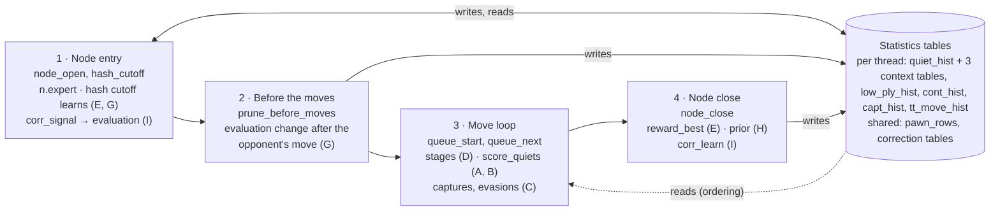
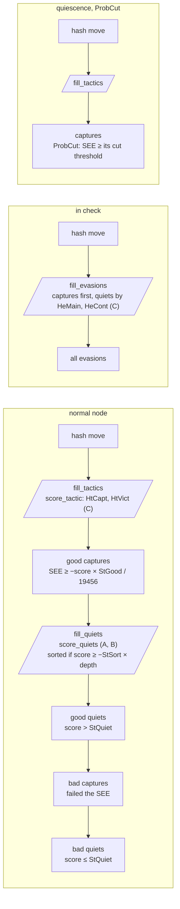

# Block 1 code map: histories and move ordering

How the histories and the move ordering of Triumviratus 8.1 work in the code: where a node reads and writes them,
the stages of the move queue, the score of a quiet move, and the call tree of every update. The design, the
parameters and the tuning queue are in the [block 1 document](../development/8.1/SEARCH_1_ORDERING.md).

Files: [`source/search/09_history.inc`](../../source/search/09_history.inc) (statistics and their updates),
[`11_queue.inc`](../../source/search/11_queue.inc) (move queue and scores),
[`13_search.inc`](../../source/search/13_search.inc) (the node), parameters in
[`01_params.inc`](../../source/search/01_params.inc).

## Experts and sub-blocks

Every node computes `n.expert = net_phase(pieces on the board)`: 0 with 9 pieces or fewer, 1 with 10 to 15, 2 with
16 to 23, 3 with 24 or more. Each parameter of the block exists four times (suffix 0 to 3) and the node uses the one
of its expert. The letters are the sub-blocks of the block document.

| | Sub-block | | Sub-block | | Sub-block |
|---|---|---|---|---|---|
| **A** | reading the histories | **D** | stages of the move queue | **G** | auxiliary updates |
| **B** | fixed terms of the ordering | **E** | how much the histories learn | **H** | the previous move |
| **C** | captures and check evasions | **F** | the saturating update | **I** | correction histories |

## 1. Where a node touches block 1



Every write goes through one function, `hist_learn` (F). The move loop only reads; the reductions and the history
pruning of the same loop read the flat quiet history, without the threat-context correction (blocks 2 and 3).

## 2. The move queue (D)

One queue per node hands out the moves one at a time. A group is generated and scored only when the queue reaches it,
so a cutoff on the hash move or on a good capture never generates the quiet moves.



Slanted boxes generate and score a group; the others hand out moves. The expert of the node and its thresholds
(`q.ex`, `q.good_capt`, `q.good_quiet`) are fixed when the queue fills, once per node.

## 3. The score of a quiet move

`score_quiets` scores every quiet move of the node in one pass; the good and bad quiet moves above are ordered by it.

```text
// A · histories, weighted by the expert, /1024
score  = ( HmMain  × (main[move] + ctx[move] × ThreatCtxW / 1024)
         + HmPawn  × pawn_rows[piece][to]
         + HmNear  × (cont[−1] + cont[−2])
         + HmFar   × (cont[−3] + cont[−4] + cont[−6])
         + HmAgree × min(|cont[−1]|, |cont[−2]|)          if the two agree in sign
         ) / 1024
       + 8 × low_ply[ply][move] × 1024 / (1024 + ply × LpDecay) × HmLow / 1024      first 5 plies

// B · fixed terms
       + ChkBonus                                          direct check, SEE ≥ ChkSee
       + ChkDisc                                           discovered check (ours, starts at 0)
       + value(piece) × (ThrEsc × leaves − ThrEnt × enters)    square attacked by a lower-value piece
       + value(piece) × ThrSafe                            escape to an unattacked square (ours, 0)

// ours since 8.0, one value for all experts
       − KingShield + OutpostOrder + PassedPush + AttackOrder
```

`ctx[move]` is the correction table of the move's threat context (two bits: from-square, to-square), read when the
factored threat history is on. `cont[−d]` is the continuation history reached through the move made d plies back.

## 4. How the statistics learn: the call tree

```text
node_close                                                                    (13_search.inc)
├─ best move found → reward_best                                                          E
│   ├─ bonus = hist_amount(BonusMul, BonusSub, BonusMax) + …   malus = hist_amount(Malus…)
│   ├─ learn_quiet(best move, +bonus × HlQBonus)
│   │   ├─ qh_push: flat table, + context table × ThreatCtxUpd  → hist_learn(HlGrav)      F
│   │   ├─ low_ply_hist   × LowPlyScale × HlAux                 → hist_learn(HlGrav)      G
│   │   ├─ learn_followups × ContUpdScale × HlAux                                         G
│   │   │     for d = 1..6 (in check 1..ContChk):
│   │   │       weight[d] × agree × (HlFNear | HlFFar) + ContNear at d = 1 → hist_learn(HlGrav)
│   │   └─ pawn_rows      × PawnBonus | PawnMalus × HlAux       → hist_learn(HlGrav)
│   ├─ learn_quiet(each quiet tried before, −malus × HlQMalus × HlQDecay^i)
│   ├─ learn_capture(best or tried capture, ± HlCBonus | HlCMalus) → hist_learn(HlCGrav)
│   ├─ learn_followups(previous move, −malus × PrevContMalus)   if it was searched first
│   └─ tt_move_hist ± TtMoveHistGood | Bad                      → hist_learn(TtmGrav)
├─ no move above alpha, previous move quiet → prior reward                                H
│   ├─ scale = Σ PriorScale terms (late if move count > PrLate) × PrGain
│   └─ learn_followups, qh_push, pawn_rows on the previous move
├─ previous move a capture → capt_hist + PrCapt               → hist_learn(HlCGrav)
└─ correction update → corr_learn                                                         I
      bonus = (best − eval) × (64·d + CorrDepthQ·d²) × k / 8192
      pawn, minor, non-pawn ×2, continuations, expert tables   → hist_learn(CorrGrav)

hash_cutoff (node entry)                                                                  E G
├─ learn_quiet(hash move, hist_amount(HashCutQuietMul, 0, HashCutQuietMax))
└─ learn_followups(previous move, −HashCutPrevMalus)

prune_before_moves (before the move loop)                                                 G
└─ diff = clamp(−(eval before + eval now)) + offset
   qh_push(opponent's move, diff × EvalDiffMul × HlEval [× EvPen if diff < 0]), pawn_rows

node entry → corr_signal = (Σ weight × correction) × CorrGain / 1024 → corrected evaluation  I
```

## 5. The two core functions

**`hist_learn(e, b, L, G)`** (F): an entry moves toward the reward and slows near the limit L.

```text
b  = clamp(b, −L, L)
e += b − e × |b| × G / (L × 1024)
```

G is the gravity of the expert: 1024 gives the old update exactly; lower keeps more, higher forgets sooner.

**`hist_amount(ex, d, mul, sub, cap)`** (E): every reward and penalty by depth.

```text
min(mul × d − sub + HlDepthQ × d² / 64, cap)
```

`HlDepthQ` = 0 is the old linear form.

## 6. The tables

| Table | Indexed by | Owner | Read by |
|---|---|---|---|
| `quiet_hist` | side, from, to, promotion; three more tables for the threat contexts | thread | ordering (A); reductions and history pruning (flat part only) |
| `low_ply_hist` | ply (first 5), move | thread | ordering (A) |
| `cont_hist` | piece and to-square of the move d plies back, then of this move | thread | ordering (A), evasions (C), reductions |
| `pawn_rows` | hash of the pawn structure, piece, to-square | shared | ordering (A) |
| `capt_hist` | piece, to-square, captured piece | thread | score of captures (C) |
| correction tables | pawn, minor-piece and non-pawn keys (mixed with the expert band), the last two moves, the expert | shared | corrected evaluation (I) |
| `tt_move_hist` | one value | thread | singular extension (block 4) |

State on 17 October 2026: every part above is rewritten in our form, with an identical search tree at the starting
values (bench 137419; 270429 with the factored threat history).
