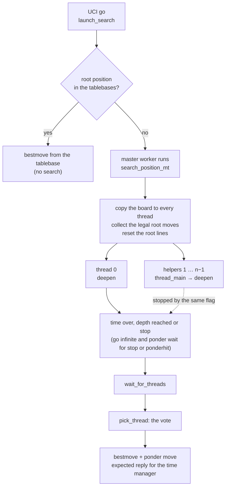

# Block 5 code map: threads

How the parallel search of Triumviratus 8.1 works in the code: how a search starts and ends, what each thread does,
what the threads share, and how the move is chosen at the end. The design and the tests are in the
[block 5 document](../development/8.1/SEARCH_5_CORE.md).

Files: [`source/search/15_threads.inc`](../../source/search/15_threads.inc) (start, stop, vote, bestmove),
[`14_deepen.inc`](../../source/search/14_deepen.inc) (iterative deepening of each thread), parameters in
[`01_params.inc`](../../source/search/01_params.inc).

## 1. A search from `go` to `bestmove`



The threads live for the whole session: each one is created once and waits on a condition variable for its next
search (`SearchWorker`), so a `go` costs no thread creation. The UCI loop stays free during the search for `stop`,
`ponderhit` and `isready`.

## 2. What each thread does

Every thread runs the same iterative deepening (`deepen`) on the same root. Lazy SMP needs no work splitting: the
threads help each other through the shared tables, and they explore different parts of the tree because they reach
the same nodes at different moments and with different bounds.

```text
deepen(td)                                                           (14_deepen.inc)
├─ SmpSkew > 0 and odd helper → start SmpSkew plies ahead           (off at 0)
└─ for each depth:
     delta = AspBase + (thread id mod SmpAspCycle) × SmpAspStep + spread of the scores / AspMeanSqDiv
     window = [average score − delta, average score + delta]
     search the root at depth − AspFhRed × (fail highs in a row) − …
       fail low  → beta = alpha + AspLoKeep/1024 of the window, alpha = result − delta, delta += AspGrowLo/128 × delta
       fail high → alpha up, beta = result + delta, delta += AspGrowHi/128 × delta
       inside    → done
     thread 0 only: time checks, output to the GUI, best-move changes for the time manager
```

The offset `(thread id mod SmpAspCycle) × SmpAspStep` gives each thread a slightly different aspiration window, so
the threads fail high and low at different moments and fill the shared table with different entries.

## 3. Shared and per-thread data

| Data | Shared | Per thread |
|---|:---:|:---:|
| transposition table | ✓ | |
| pawn-structure history, correction histories | ✓ | |
| quiet, first-ply, continuation and capture histories, hash-move history | | ✓ |
| board, stack of the search, root lines | | ✓ |
| stop flag, clock | ✓ | |

## 4. The vote (`pick_thread`)

When the search stops, every thread has a best line. The move comes from the thread with the strongest support.

```text
share(thread)   = (score − lowest score among the threads + SmpVoteBase) × SmpVoteScore / 1024
                  + SmpVoteDepth × completed depth
support(move)   = Σ share(thread) over the threads whose best move is that move

order of preference, thread by thread:
  1. a decided and complete result (mate or tablebase score, without a bound); the larger one wins
  2. otherwise, a result that is not lost, with more support
  3. equal support → the longer line
```

| Parameter | Start | What it changes |
|---|---:|---|
| `SmpVoteBase` | 14 | support of a thread with the lowest score |
| `SmpVoteScore` | 1024 | weight of the score in the support |
| `SmpVoteDepth` | 0 | support per completed ply, so a deeper thread counts more |
| `SmpAspCycle`, `SmpAspStep` | 8, 1 | offset of the aspiration window of each thread |
| `SmpSkew` | 0 | plies by which the odd helper threads start ahead |

At the starting values the behaviour is the one before the rewrite. With one thread nothing of this section acts:
the bench is identical (137419).

## 5. The rest of block 5

The aspiration windows are rewritten (section 2). Quiescence search (`12_quiesce.inc`) and the use of the
transposition table (`13_search.inc`) are rewritten next, at an identical tree; this map grows with them.
